# Documento de Projeto do ArchFlow

PUC-Campinas · Sistemas de Informação · Projeto Integrador IV · Turma 0102 · Grupo 07 · 2026-2

**Integrantes:** Ana Clara Dias Xavier, Lara Louise Ferreira Limas, Luis Felipe Moura, Matheus Henrique Mansano, Mirele Cristina Santos Separovic.

## Sumário

- [1. Visão geral](#1-visão-geral)
- [2. Objetivos](#2-objetivos)
- [3. Requisitos](#3-requisitos)
- [4. Arquitetura](#4-arquitetura)
- [5. Banco de dados](#5-banco-de-dados)
- [6. Contratos e decisões](#6-contratos-e-decisões)
- [7. Testes](#7-testes)
- [8. Principais telas](#8-principais-telas)
- [9. Como rodar](#9-como-rodar)
- [10. Conclusão](#10-conclusão)
- [11. Anexos](#11-anexos)

## 1. Visão geral

### **1.1 Problema**
Atualmente, a solicitação e a retirada de materiais no Ateliê CEATEC da PUC-Campinas ocorrem de maneira predominantemente presencial e informal. Os alunos precisam se deslocar até o laboratório para consultar a disponibilidade dos materiais, verificar suas especificações e obter informações sobre a previsão de retirada. Não há um sistema centralizado que permita realizar essas consultas e acompanhar as solicitações digitalmente.

Essa situação também afeta os responsáveis pelo ateliê, que precisam organizar os pedidos de forma manual, acompanhar a disponibilidade dos materiais e realizar o controle do estoque sem um histórico centralizado das solicitações. Com isso, torna-se mais difícil visualizar antecipadamente as demandas e planejar a reposição dos materiais.

Dessa forma, o problema central identificado é a ausência de um processo digital e centralizado que conecte as solicitações dos alunos ao controle de estoque e ao atendimento realizado pelos responsáveis do CEATEC.

**Principais impactos identificados:**

* **Para os alunos:** deslocamentos desnecessários, dificuldade para consultar previamente a disponibilidade e as especificações dos materiais e falta de previsibilidade sobre o andamento e a retirada dos pedidos.
* **Para os responsáveis:** organização manual das solicitações, dificuldade para acompanhar a demanda, controlar o estoque e manter um histórico que auxilie no planejamento de compras e reposições.

**Evidências do diagnóstico:**

O problema foi identificado a partir do diagnóstico inicial apresentado nas etapas de empatia e definição do projeto, que descrevem a dependência de consultas presenciais, a ausência de acompanhamento centralizado e as dificuldades de organização do estoque e das solicitações. Esses pontos também foram organizados na definição do MVP, que apresenta a necessidade de centralizar o processo em uma plataforma digital.

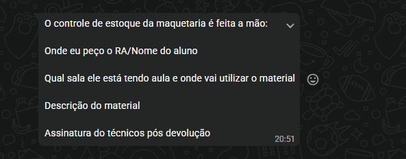

*Figura 1 \- Evidência do problema*

### **1.2 Público-alvo**
O ArchFlow tem como público-alvo os usuários envolvidos no processo de solicitação, disponibilização e gerenciamento de materiais do Ateliê CEATEC da PUC-Campinas. A plataforma foi planejada para atender dois perfis principais: os alunos de Arquitetura e Urbanismo que utilizam os materiais em suas atividades acadêmicas e os responsáveis pelo Ateliê CEATEC, que realizam o gerenciamento dos materiais, do estoque e das solicitações recebidas.

Embora os dois perfis utilizem a mesma plataforma, suas necessidades e responsabilidades são diferentes. Por esse motivo, o sistema apresenta funcionalidades direcionadas a cada tipo de usuário, buscando organizar o fluxo de atendimento e centralizar as informações relacionadas aos materiais.

**Alunos de Arquitetura e Urbanismo**

Esse perfil compreende os estudantes que utilizam os materiais disponibilizados pelo Ateliê CEATEC para a realização de maquetes, modelos físicos, trabalhos práticos e demais projetos acadêmicos relacionados ao curso.

Durante o desenvolvimento de suas atividades, esses alunos precisam identificar os materiais adequados para cada projeto, considerando características como tipo de material, especificações técnicas, dimensões, diâmetro e quantidade necessária. A falta de informações prévias sobre a disponibilidade desses itens pode gerar deslocamentos desnecessários até o ateliê e dificuldades no planejamento das atividades acadêmicas.

Nesse contexto, o ArchFlow oferece aos alunos um ambiente para consultar o catálogo de materiais, visualizar suas especificações e verificar as quantidades disponíveis antes de realizar uma solicitação. A plataforma também permite registrar os pedidos informando o material desejado, suas características e a quantidade necessária.

Após o envio da solicitação, o aluno pode acompanhar seu andamento por meio dos status disponibilizados pelo sistema, desde o registro do pedido até sua liberação para retirada e conclusão do atendimento. Também pode consultar o histórico de solicitações anteriores e receber notificações sobre alterações relevantes, como indisponibilidade de materiais ou liberação do pedido para retirada.

Dessa forma, o sistema busca proporcionar maior visibilidade sobre os materiais disponíveis, facilitar o planejamento dos trabalhos acadêmicos e reduzir a necessidade de consultas presenciais para obter informações sobre os pedidos.

**Responsáveis pelo Ateliê CEATEC**

Esse perfil corresponde aos integrantes da equipe responsável pelo atendimento e gerenciamento dos materiais disponibilizados pelo Ateliê CEATEC. Esses usuários atuam diretamente no controle das informações do estoque e no acompanhamento das solicitações realizadas pelos alunos.

No processo atual apresentado no diagnóstico do projeto, parte dessas atividades depende de controles manuais e de interações presenciais, o que dificulta a organização das demandas, a consulta ao histórico de pedidos e a identificação antecipada das necessidades de reposição de materiais.

Para atender esse público, o ArchFlow disponibiliza funcionalidades administrativas voltadas ao gerenciamento dos materiais e das solicitações. Por meio do sistema, os responsáveis podem consultar os pedidos recebidos, visualizar as informações registradas pelos alunos e organizar o atendimento conforme as etapas definidas para o fluxo de solicitações.

Também podem cadastrar e gerenciar os materiais, consultar e atualizar as quantidades disponíveis em estoque e identificar situações de indisponibilidade. Quando um material solicitado não está disponível, o sistema permite registrar essa condição, indicando a necessidade de compra ou reposição.

Outra atividade importante é a atualização dos status das solicitações, permitindo que o andamento do atendimento seja registrado na plataforma e acompanhado pelos alunos. O histórico centralizado dos pedidos também contribui para a consulta de solicitações anteriores e poderá servir como apoio ao planejamento de compras e à reposição de materiais.

Dessa maneira, o ArchFlow busca auxiliar os responsáveis na organização das atividades do ateliê, na centralização das informações e no controle das solicitações e do estoque.

### **1.3 Escopo do sistema**
O ArchFlow contempla funcionalidades organizadas de acordo com os dois perfis de acesso, Aluno e Responsável CEATEC. Essas funcionalidades abrangem as seguintes operações:

**Autenticação e perfis de acesso**

O sistema disponibiliza acesso por meio de autenticação de usuários, diferenciando dois perfis: Aluno e Responsável CEATEC. Essa separação permite direcionar as funcionalidades de acordo com as atividades de cada usuário. Enquanto os alunos acessam os recursos relacionados à consulta e solicitação de materiais, os responsáveis utilizam as funcionalidades administrativas de gerenciamento do estoque e atendimento dos pedidos.

**Catálogo de materiais**

Disponibiliza um catálogo digital com os materiais cadastrados no Ateliê CEATEC. Por meio dessa funcionalidade, os alunos podem consultar os itens e visualizar suas informações, incluindo especificações técnicas e características necessárias para a escolha do material. Entre os dados apresentados estão dimensões, diâmetro, quando aplicável, e quantidade disponível.

**Registro de solicitações**

Permite que os alunos registrem solicitações de materiais diretamente pela plataforma, selecionando o item desejado e informando as características necessárias, como dimensões, diâmetro e quantidade. As informações são armazenadas no sistema, permitindo que os responsáveis tenham acesso aos pedidos e possam organizar seu atendimento.

**Fila de atendimento**

Disponibiliza aos responsáveis uma visualização das solicitações recebidas, centralizando os pedidos em uma fila de atendimento. Essa funcionalidade facilita a organização e a identificação das demandas pendentes, permitindo que a equipe acompanhe os pedidos que precisam ser atendidos.

**Controle de estoque**

Permite que os responsáveis consultem e atualizem as quantidades disponíveis dos materiais cadastrados. O controle dessas informações auxilia na identificação de itens disponíveis, com estoque baixo ou indisponíveis. O sistema também contempla o registro de situações em que um material solicitado não está disponível, indicando a necessidade de compra ou reposição.

**Atualização e acompanhamento de status**

O sistema permite registrar e acompanhar as diferentes etapas de atendimento de uma solicitação. O fluxo contempla os seguintes status: Pendente, Em Separação, Aguardando Compra, Pronto para Retirada e Concluído. Os responsáveis realizam as atualizações conforme o andamento do pedido, enquanto os alunos podem consultar a situação atual de suas solicitações pela plataforma.

**Notificações internas**

Disponibiliza avisos internos para comunicar os alunos sobre alterações relevantes relacionadas às suas solicitações. Entre as situações contempladas estão a indisponibilidade de um material e a liberação do pedido para retirada.

**Histórico de solicitações**

Mantém o registro dos pedidos realizados, incluindo as informações relacionadas aos materiais solicitados. O histórico permite consultar solicitações anteriores e recuperar informações sobre os atendimentos, contribuindo também para que os responsáveis tenham uma referência das demandas registradas no sistema.

**Consulta de prazos e previsão de retirada**

Permite consultar as informações relacionadas à previsão de retirada dos materiais, auxiliando o aluno no planejamento da retirada e na organização de suas atividades acadêmicas.

### **1.4 Fora do escopo**
O ArchFlow possui um escopo delimitado às funcionalidades previstas para o gerenciamento de materiais e solicitações do Ateliê CEATEC. Dessa forma, algumas funcionalidades não serão contempladas no desenvolvimento atual do sistema:

* Aplicativo mobile nativo: o projeto não prevê o desenvolvimento de um aplicativo específico para dispositivos Android ou iOS.
* Compra automática de materiais com fornecedores: o sistema não realizará pedidos de compra diretamente com fornecedores. A identificação da necessidade de reposição ficará restrita ao registro e acompanhamento das informações de estoque.
* Agendamento de horários fixos para retirada: não haverá um módulo para reservar horários específicos de retirada dos materiais.
* Chat em tempo real: o sistema não oferecerá um canal de comunicação instantânea entre alunos e responsáveis pelo ateliê.
* Gerenciamento de múltiplos ateliês: a solução será direcionada ao gerenciamento do Ateliê CEATEC, sem contemplar a administração de diferentes ateliês ou unidades.

## 2. Objetivos

### **2.1 Objetivo Geral**
Desenvolver uma plataforma web para a gestão das solicitações e do estoque de materiais do Ateliê CEATEC, centralizando os processos de consulta, registro e acompanhamento de pedidos. A solução tem como finalidade permitir que os alunos consultem os materiais disponíveis e acompanhem suas solicitações, enquanto os responsáveis pelo Ateliê realizam o controle do estoque, organizam a fila de atendimento e atualizam o andamento dos pedidos.

### **2.2 Objetivos Específicos**
Para alcançar o objetivo geral, foram estabelecidos os seguintes objetivos específicos na Entrega 01:

**OE1 – Consulta e solicitação de materiais:** Disponibilizar aos alunos a consulta dos materiais cadastrados, apresentando suas especificações e disponibilidade, bem como permitir o registro de solicitações com os respectivos parâmetros necessários.

**OE2 – Gestão das solicitações e do estoque:** Disponibilizar aos responsáveis pelo CEATEC recursos para organizar as solicitações recebidas, controlar as quantidades disponíveis em estoque e atualizar o status dos pedidos conforme o andamento do atendimento.

**OE3 – Acompanhamento das solicitações:** Permitir que alunos e responsáveis consultem o histórico das solicitações e suas informações relevantes, incluindo alterações de status e notificações relacionadas à indisponibilidade de materiais.

## 3. Requisitos

### **3.1 Requisitos Funcionais**
Prioridades: Alta, Média ou Baixa. Status: Pronto, Parcial ou Cortado.

**E1 \- Autenticação e perfis de acesso** \| Prioridade: Alta \| Status: Pronto

* O usuário acessa o sistema com e-mail e senha e recebe um token de autenticação.
* O sistema diferencia os perfis Aluno e Responsável CEATEC e libera as funcionalidades de cada um.
* O aluno pode se cadastrar pela tela de cadastro e acessa o sistema sem novo login.
* Credenciais inválidas ou usuário inativo são rejeitados com mensagem de erro.

**E2 \- Catálogo de materiais** \| Prioridade: Alta \| Status: Pronto

* *O aluno consulta os materiais com nome, descrição, especificação e quantidade disponível.*
* *A busca por nome retorna apenas os materiais correspondentes.*
* *O responsável cadastra novos materiais informando as quantidades disponível e mínima.*

***E3 \- Registro de solicitações** \| Prioridade: Alta \| Status:* Pronto

* *O aluno registra uma solicitação informando material e quantidade; dimensão, diâmetro e observação são opcionais.*
* *A solicitação é criada com o status inicial Pendente.*
* *Material inexistente ou inativo e quantidade inválida são rejeitados.*

***E4 \- Fila de atendimento** \| Prioridade: Alta \| Status:* Pronto

* O responsável visualiza as solicitações recebidas e pode filtrar por status.
* O aluno não tem acesso à fila.

**E5 \- Controle de estoque** \| Prioridade: Alta \| Status: Pronto

* O responsável atualiza a quantidade disponível e o novo valor substitui o saldo anterior.
* O sistema indica se o estoque de um material está disponível, baixo ou indisponível.
* Quantidade inválida é rejeitada.

**E6 \- Fluxo de status das solicitações** \| Prioridade: Alta \| Status: Pronto

* O responsável altera o status conforme o fluxo: Pendente, Em Separação, Aguardando Compra, Pronto para Retirada e Concluído.
* Transições inválidas e previsão de retirada no passado são rejeitadas.
* Cada alteração de status gera uma notificação para o aluno, na mesma transação.

**E7 \- Notificações internas** \| Prioridade: Média \| Status: Pronto

* O aluno é notificado sobre indisponibilidade de material e liberação para retirada.
* O usuário consulta suas notificações e pode filtrar as não lidas.
* A consulta não altera o estado de leitura.

**E8 \- Histórico de solicitações** \| Prioridade: Média \| Status: Pronto

* O aluno vê apenas as próprias solicitações.
* O responsável vê as solicitações de todos os alunos.

**E9 \- Painel de prazos** \| Prioridade: Média \| Status: Pronto

* O aluno vê material, quantidade, status e previsão de retirada de cada solicitação.
* Solicitações sem previsão definida são exibidas sem data, sem gerar erro.

### **3.2 Requisitos Não Funcionais**
| ID  | Requisito  | Forma de verificação  |
| :---- | :---- | :---- |
|  RNF01 | As senhas devem ser armazenadas com hash BCrypt, e o acesso deve usar token JWT com validade de oito horas (ADR 0008).  | Conferir no banco que `senha_hash` não contém texto puro e verificar que um token expirado é recusado pela API.  |
| RNF02 | O acesso às operações deve respeitar o perfil do usuário.  | Tentar acessar a fila (CT04) com perfil Aluno e confirmar a recusa.  |
| RNF03 | O banco deve manter a integridade dos dados por meio de restrições e chaves estrangeiras, com tabelas criadas por scripts SQL e `ddl-auto: validate` (ADR 0005).  | Iniciar o backend com a estrutura divergente das entidades e confirmar que ele recusa a inicialização; tentar inserir registro com referência inexistente.  |
| RNF04 | Os erros da API devem seguir um padrão de códigos e mensagens com o código HTTP correspondente (ADR 0004).  | Provocar erros (credencial inválida, material inexistente) e conferir o formato da resposta.  |
| RNF05 | O ambiente deve poder ser iniciado localmente com Docker Compose, incluindo a interface, a API e o banco de dados.  | Iniciar o sistema em um ambiente limpo, acessar a interface e realizar uma operação autenticada, confirmando que os dados foram gravados no banco. Isso demonstra a reprodução do ambiente local, mas não comprova, por si só, a instalação no ambiente compartilhado.  |

### **3.3 Rastreabilidade dos Requisitos**
| Requisito | Fluxo do sistema  | Contratos | Testes |
| :---- | :---- | :---- | :---- |
| E1 | Login e cadastro | CT01, CT10, CT14 | AutenticacaoServiceTest, AutenticacaoBancoTest, CadastroAlunoBancoTest e sessao.test.js. |
| E2 | Consulta e cadastro de materiais  | CT02, CT11, POST /api/materiais  | MaterialTest e MaterialEstoqueTest |
| E3 | Criação de solicitação | CT03, CT12 | SolicitacaoCriacaoTest, SolicitacaoCriacaoBancoTest, solicitacao.test.js e sessao.test.js. |
| E4 | Fila de atendimento | CT04, CT12 | SolicitacaoFilaSaidaTest, SolicitacaoServiceTest, SolicitacaoCriacaoBancoTest e fila.test.js. |
| E5 | Atualização de estoque | CT02, CT05, CT11 | MaterialEstoqueTest, MaterialEstoqueBancoTest, estoque.test.js e sessao.test.js.  |
| E6 | Atualização de status | CT06, CT12, CT13 | SolicitacaoTest, SolicitacaoServiceTest, SolicitacaoCriacaoBancoTest, NotificacaoBancoTest e sessao.test.js. |
| E7 | Noticações | CT07, CT13 | NotificacaoConsultaTest, NotificacaoTokenTest e NotificacaoBancoTest. |
| E8 | Histórico | CT08, CT12 | SolicitacaoCriacaoBancoTest e SolicitacaoServiceTest. |
| E9 | Prazos | CT09, CT12 | sessao.test.js |

## 4. Arquitetura

### **4.1 Visão Geral da Arquitetura**
O ArchFlow v1.0 reúne uma aplicação web para alunos e responsáveis do Ateliê CEATEC, uma API Spring Boot e um banco PostgreSQL. O navegador carrega a aplicação React e chama a API pelo caminho relativo /api. O serviço frontend encaminha essas chamadas ao backend pela rede do Docker Compose. A API autentica o usuário, aplica as regras de materiais, estoque, solicitações e avisos, e acessa o PostgreSQL por JDBC e JPA.

**Figura 4.1. Diagrama de contêineres do ArchFlow v1.0**

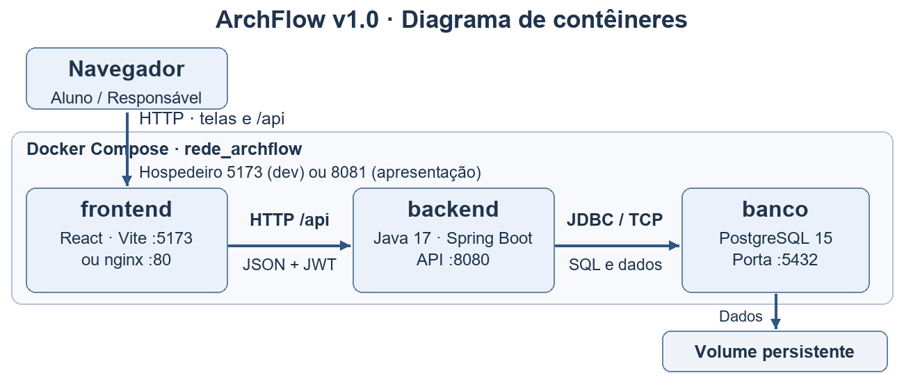

*Fonte: elaboração do grupo a partir dos arquivos Compose e Dockerfiles da versão v1.0.*

### ## **4.2 Serviços e Containers**
Os dois arquivos Compose ficam no repositório do backend. Os três serviços compartilham a rede bridge rede\_archflow. A tabela mostra as portas internas e as publicações conforme os valores padrão da configuração.

| Serviço | Imagem ou construção | Porta interna | Publicação no hospedeiro | Dependência |
| :---- | :---- | :---- | :---- | :---- |
| frontend | Desenvolvimento: node:20-alpine com Vite. Apresentação: build do frontend com Node 20 e nginx:alpine na imagem final. | 5173 dev / 80 apresentação | 5173 dev / 127.0.0.1:8081 apresentação | backend (ordem de início) |
| backend | Build local. Maven 3.9 com Temurin 17 na compilação e eclipse-temurin:17-jre na execução. | 8080 | 8080 dev / 127.0.0.1:8080 apresentação | banco saudável (pg\_isready) |
| banco | postgres:15-alpine | 5432 | 5432 dev / interna na apresentação (sem ports) | Nenhuma |

A inicialização de um volume vazio executa os scripts de banco/ montados em modo somente leitura. O PostgreSQL persiste os dados em dados\_do\_banco no desenvolvimento e em dados\_do\_banco\_demo na apresentação. O Hibernate confere a compatibilidade do esquema na partida com ddl-auto=validate. As variáveis do ambiente definem as portas, a conexão JDBC e o segredo do JWT.

[Compose de desenvolvimento](https://github.com/MatheusMansano06/pi4-0102-g7-backend-1/blob/v1.0/docker-compose.yml) · [Compose de apresentação](https://github.com/MatheusMansano06/pi4-0102-g7-backend-1/blob/v1.0/docker-compose.prod.yml)

### **4.3 Comunicação entre os Componentes**
O navegador envia requisições HTTP à mesma origem da interface. Em desenvolvimento, o Vite repassa /api para http://backend:8080. Na apresentação, o nginx serve o React compilado e encaminha /api ao mesmo serviço, preservando o cabeçalho Host com a porta. As operações enviam e recebem JSON. Após o login, as rotas protegidas recebem o JWT no cabeçalho Authorization: Bearer.

A v1.0 tem um único backend Java. A comunicação entre aplicações é HTTP, sem um segundo backend ou protocolo de socket próprio. Na fronteira de dados, o backend é cliente JDBC e o PostgreSQL atende como servidor em banco:5432, com o protocolo do PostgreSQL sobre TCP. As rotas e os formatos de mensagem estão nas fichas CT do capítulo 6\.

Se a API estiver indisponível, a interface deixa de consultar ou gravar os dados e apresenta erro. A consulta pode ser repetida após o serviço voltar, sem fila de reenvio automático de gravações. Se o banco ainda não estiver saudável na partida, o Compose condiciona o início do backend ao healthcheck. Uma falha ao persistir o aviso na mesma transação de atualização de status desfaz a alteração da solicitação.

### **4.4 Tecnologias Utilizadas**
| Camada | Tecnologia e versão | Motivo da escolha |
| :---- | :---- | :---- |
| Interface Web | React 19.3.1, Vite 8.3.5, JavaScript, HTML e CSS | Organiza telas e componentes dos dois perfis e gera os arquivos estáticos da apresentação. |
| API e persistência | Java 17, Spring Boot 3.2.5, Spring Data JPA e Maven 3.9 | Concentra as regras na API HTTP e mapeia as entidades Java para as tabelas do PostgreSQL. |
| Banco | PostgreSQL 15 | Mantém relacionamentos entre usuários, materiais, solicitações e avisos, com integridade referencial e transações. |
| Execução | Docker Compose 5.5.1 (ambiente do ensaio), Node.js 20 e nginx:alpine | Reproduz os três serviços em uma rede. Node compila a interface e nginx entrega os arquivos estáticos e encaminha a API na apresentação. |

### **4.5 Decisões Arquiteturais**
O capítulo 6 reúne os ADRs. Para reproduzir a versão entregue, consulte as decisões sobre [Java e Spring Boot (ADR 0001\)](https://github.com/MatheusMansano06/pi4-0102-g7-backend-1/blob/v1.0/docs/adr/0001-adotar-java-com-spring-boot-como-backend.md), [criação do banco por SQL (ADR 0005\)](https://github.com/MatheusMansano06/pi4-0102-g7-backend-1/blob/v1.0/docs/adr/0005-criar-o-banco-por-script-sql.md), [Compose com dois repositórios (ADR 0006\)](https://github.com/MatheusMansano06/pi4-0102-g7-backend-1/blob/v1.0/docs/adr/0006-ambiente-docker-com-dois-repositorios.md) e [login próprio com BCrypt/JWT (ADR 0008\)](https://github.com/MatheusMansano06/pi4-0102-g7-backend-1/blob/v1.0/docs/adr/0008-login-proprio-sem-keycloak.md).

## 5. Banco de dados

### **5.1 Modelo do Banco de Dados**
O banco de dados do sistema ArchFlow foi desenvolvido utilizando o Sistema Gerenciador de Banco de Dados PostgreSQL. Sua estrutura foi organizada para armazenar e relacionar as informações necessárias ao funcionamento do sistema, abrangendo o gerenciamento de usuários, o controle de materiais e estoque, o registro de solicitações e o gerenciamento de notificações.

O modelo relacional é composto por quatro tabelas principais: usuários, materiais, solicitações e notificações.

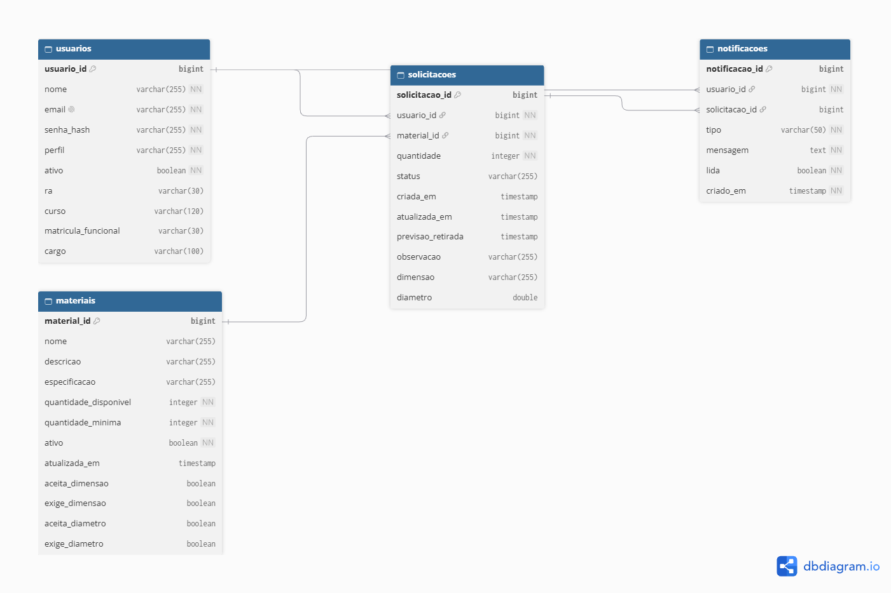

*Figura 2 – Modelo Entidade-Relacionamento do banco de dados ArchFlow.*

A estrutura contempla os seguintes relacionamentos:

* **Usuários e Solicitações:** relacionamento de um para muitos (1:N). Um usuário pode registrar diversas solicitações, enquanto cada solicitação está vinculada a um único usuário.
* **Materiais e Solicitações:** relacionamento de um para muitos (1:N). Um material pode estar associado a diversas solicitações, enquanto cada solicitação referencia um único material.
* **Usuários e Notificações:** relacionamento de um para muitos (1:N). Um usuário pode possuir diversas notificações, sendo que cada notificação está vinculada a um único usuário.
* **Solicitações e Notificações:** relacionamento de um para muitos (1:N), com associação opcional do lado das notificações. Uma solicitação pode estar relacionada a várias notificações, enquanto uma notificação pode estar associada a uma solicitação ou não.

### **5.2 Estrutura das Tabelas**
O banco de dados é composto por quatro tabelas, responsáveis por armazenar as informações necessárias ao funcionamento do sistema. A seguir, são apresentados os campos, os tipos de dados e a finalidade de cada tabela.

**Tabela usuários:**

A tabela usuários armazena os dados cadastrais e de identificação dos usuários do sistema. Ela contempla os perfis de aluno e responsável, diferenciados pelo atributo perfil, além de armazenar os dados específicos de cada categoria.

| Campo | Tipo de dado | Descrição |
| ----- | ----- | ----- |
| usuario\_id (PK) | BIGINT | Identificador único do usuário. |
| nome | VARCHAR(255) | Nome do usuário. |
| email | VARCHAR(255) | Endereço de e-mail utilizado no acesso. |
| senha\_hash | VARCHAR(255) | Hash da senha do usuário. |
| perfil | VARCHAR(255) | Perfil de acesso: ALUNO ou RESPONSAVEL. |
| ativo | BOOLEAN | Indica se o cadastro está ativo. |
| ra | VARCHAR(30) | Registro acadêmico do aluno. |
| curso | VARCHAR(120) | Curso ao qual o aluno está vinculado. |
| matricula\_funcional | VARCHAR(30) | Matrícula funcional do responsável. |
| cargo | VARCHAR(100) | Cargo do responsável. |

**Tabela materiais:**

A tabela materiais armazena os materiais cadastrados no sistema e suas informações de estoque. Seus atributos permitem identificar cada material, controlar as quantidades disponíveis e mínimas e definir as condições de utilização de dimensões e diâmetros nas solicitações.

| Campo | Tipo de dado | Descrição |
| ----- | ----- | ----- |
| material\_id (PK) | BIGINT | Identificador único do material. |
| nome | VARCHAR(255) | Nome do material. |
| descricao | VARCHAR(255) | Descrição do material. |
| especificacao | VARCHAR(255) | Especificação do material. |
| quantidade\_disponivel | INTEGER | Quantidade atualmente disponível em estoque. |
| quantidade\_minima | INTEGER | Limite mínimo de estoque definido para o material. |
| ativo | BOOLEAN | Indica se o material está ativo no sistema. |
| atualizada\_em | TIMESTAMP | Data e horário da última atualização do estoque. |
| aceita\_dimensao | BOOLEAN | Indica se o material permite informar dimensões. |
| exige\_dimensao | BOOLEAN | Indica se a dimensão é obrigatória na solicitação. |
| aceita\_diametro | BOOLEAN | Indica se o material permite informar o diâmetro. |
| exige\_diametro | BOOLEAN | Indica se o diâmetro é obrigatório na solicitação. |

**Tabela solicitacoes:**

A tabela solicitacoes registra os pedidos de materiais realizados pelos usuários. Armazena informações sobre o material solicitado, a quantidade, o estado atual do atendimento e os dados complementares necessários ao processamento da solicitação.

| Campo | Tipo de dado | Descrição |
| ----- | ----- | ----- |
| solicitacao\_id (PK) | BIGINT | Identificador único da solicitação. |
| usuario\_id (FK) | BIGINT | Referência ao usuário que realizou a solicitação. |
| material\_id (FK) | BIGINT | Referência ao material solicitado. |
| quantidade | INTEGER | Quantidade de unidades solicitadas. |
| status | VARCHAR(255) | Situação atual da solicitação. |
| criada\_em | TIMESTAMP | Data e horário de criação da solicitação. |
| atualizada\_em | TIMESTAMP | Data e horário da última atualização da solicitação. |
| previsao\_retirada | TIMESTAMP | Data e horário previstos para retirada do material. |
| observacao | VARCHAR(255) | Observações adicionais registradas pelo usuário. |
| dimensao | VARCHAR(255) | Dimensão informada para o material, quando aplicável. |
| diametro | DOUBLE PRECISION | Diâmetro informado para o material, quando aplicável. |

**Tabela notificacoes:**

A tabela de notificações armazena as mensagens geradas pelo sistema para informar os usuários sobre eventos relacionados ao atendimento de suas solicitações. Cada registro identifica o destinatário, o conteúdo da notificação e seu estado de leitura. A associação com uma solicitação é opcional.

| Campo | Tipo de dado | Descrição |
| ----- | ----- | ----- |
| notificacao\_id (PK) | BIGINT | Identificador único da notificação. |
| usuario\_id (FK) | BIGINT | Referência ao usuário destinatário. |
| solicitacao\_id (FK) | BIGINT | Referência opcional à solicitação relacionada. |
| tipo | VARCHAR(50) | Classificação do tipo de notificação. |
| mensagem | TEXT | Conteúdo textual da notificação. |
| lida | BOOLEAN | Indica se a notificação foi visualizada. |
| criado\_em | TIMESTAMP | Data e horário de criação da notificação. |

As tabelas utilizam restrições para manter a consistência dos dados. Entre elas estão a identificação única dos registros, a validação dos perfis de usuários, a obrigatoriedade de campos específicos e a verificação de valores permitidos para quantidades e diâmetros. As chaves estrangeiras também garantem que as referências entre usuários, materiais, solicitações e notificações correspondem a registros existentes.

## 6. Contratos e decisões

### **6.1 Contratos de Comunicação**
Os contratos de comunicação definem como o frontend, backend e banco de dados trocam informações durante o funcionamento do ArchFlow. Eles descrevem as operações realizadas, os dados enviados e recebidos e os possíveis erros, ajudando a manter a integração entre os componentes organizada.

Os contratos CT01 a CT13 foram definidos durante o desenvolvimento do sistema. Posteriormente, foi acrescentado o CT14, referente ao cadastro de alunos. A seguir, são apresentados os contratos e suas respectivas funcionalidades.

**CT01 — Autenticação de Usuário**

**Operação:** POST /api/auth/login

**Descrição:** Permite que alunos e responsáveis acessem o sistema utilizando e-mail e senha.

**Entrada:** E-mail e senha.

**Saída:** Identificador do usuário, nome, curso (quando aluno), perfil e token de autenticação.

**Possíveis erros:** Credenciais inválidas, dados incorretos, usuário inativo ou erro interno.

**Requisito atendido:** E1 — Autenticação e perfis.

**CT02 — Consulta de Materiais**

**Operação:** GET /api/materiais

**Descrição:** Permite consultar os materiais cadastrados e suas informações, incluindo especificações e disponibilidade no estoque. A busca pela API é realizada pelo nome do material.

**Entrada:** Termo de busca opcional (busca).

**Saída:** Lista de materiais contendo identificador, nome, descrição, especificação, quantidade disponível e status do estoque.

**Possíveis erros:** Falha na consulta ou erro interno.

**Requisitos atendidos:** E2 — Catálogo de materiais; E5 — Controle de estoque.

**CT03 — Criação de Solicitação**

**Operação:** POST /api/solicitacoes

**Descrição:** Permite que o aluno registre uma solicitação de material, informando a quantidade desejada e os dados complementares, quando necessários.

**Entrada:** Identificador do material, quantidade, dimensão, diâmetro e observação. Os três últimos são opcionais.

**Saída:** Identificador da solicitação, identificador do material, quantidade, status inicial PENDENTE, data de criação e informações complementares.

**Possíveis erros:** Dados inválidos, quantidade incorreta, material inexistente ou inativo, usuário sem permissão ou erro na gravação.

**Requisito atendido:** E3 — Registro de solicitações.

**CT04 — Consulta da Fila de Atendimento**

**Operação:** GET /api/solicitacoes/fila

**Descrição:** Permite que o responsável consulte as solicitações recebidas e organize o atendimento de acordo com os status.

**Entrada:** Filtro de status opcional.

**Saída:** Lista de solicitações contendo aluno, material, quantidade, status, data de criação, previsão de retirada, dimensão, diâmetro e observação.

**Possíveis erros:** Usuário não autenticado, aluno tentando acessar a fila, status inválido ou erro na consulta.

**Requisito atendido:** E4 — Fila de atendimento.

**CT05 — Atualização de Estoque**

**Operação:** PATCH /api/materiais/{materialId}/estoque

**Descrição:** Permite que o responsável atualize a quantidade disponível de determinado material. O valor informado substitui o saldo anterior.

**Entrada:** Identificador do material e nova quantidade disponível.

Saída: Identificador do material, quantidade atualizada e data da atualização.

**Possíveis erros:** Material inexistente, quantidade inválida, usuário sem permissão ou erro na atualização.

**Requisito atendido:** E5 — Controle de estoque.

A operação foi integrada e testada no ambiente Docker do projeto, porém sua ativação depende da configuração do backend.

**CT06 — Atualização de Status da Solicitação**

**Operação:** PATCH /api/solicitacoes/{solicitacaoId}/status

**Descrição:** Permite que o responsável altere o status da solicitação durante o atendimento e informe uma previsão de retirada, quando necessário.

**Entrada:** Identificador da solicitação, novo status e previsão de retirada opcional.

**Saída:** Identificador da solicitação, status atualizado, previsão de retirada e data da atualização.

**Possíveis erros:** Solicitação inexistente, status ou transição inválida, previsão no passado, usuário sem permissão ou erro na atualização.

**Requisito atendido:** E6 — Fluxo de status das solicitações.

A atualização do status também gera notificações para o aluno. Essas operações são realizadas na mesma transação, evitando que uma alteração seja salva sem o registro da notificação correspondente.

**CT07 — Consulta de Notificações**

**Operação:** GET /api/notificacoes

**Descrição:** Permite que o usuário consulte as notificações recebidas, podendo filtrar aquelas que ainda não foram lidas.

**Entrada:** Parâmetro opcional somenteNaoLidas, com valor true ou false.

**Saída:** Objeto contendo a lista de notificações, com identificador, mensagem, tipo, data de criação, status de leitura e identificador da solicitação relacionada, quando houver.

**Possíveis erros:** Usuário não autenticado, parâmetro inválido ou erro na consulta.

**Requisito atendido:** E7 — Notificações internas.

As notificações são exibidas ao usuário correspondente. A consulta não altera automaticamente o status de leitura.

**CT08 — Consulta ao Histórico**

**Operação:** GET /api/solicitacoes/historico

**Descrição:** Permite consultar solicitações anteriores e acompanhar suas informações e status.

**Entrada:** Não necessita de parâmetros adicionais. A identificação do usuário é obtida pela autenticação.

**Saída:** Lista de solicitações contendo identificador, aluno, material, quantidade, status, datas de criação e atualização, dimensão e previsão de retirada.

**Possíveis erros:** Usuário não autenticado ou erro na consulta.

**Requisito atendido:** E8 — Histórico de solicitações.

O aluno visualiza suas próprias solicitações, enquanto o responsável pode consultar as solicitações de todos os alunos.

**CT09 — Consulta de Prazos**

**Operação:** GET /api/solicitacoes/prazos

**Descrição:** Permite que o aluno acompanhe suas solicitações e as respectivas previsões de retirada.

**Entrada:** Não necessita de parâmetros adicionais.

**Saída:** Lista de solicitações contendo identificador, material, quantidade, dimensão, status, datas de criação e atualização e previsão de retirada, quando definida.

**Possíveis erros:** Usuário não autenticado ou erro na consulta.

**Requisito atendido:** E9 — Painel de prazos.

A consulta utiliza os dados das solicitações, apresentando a previsão de retirada quando informada pelo responsável.

**CT10 — Consulta de Usuários**

**Operação:** Comunicação interna entre backend e banco de dados.

**Descrição:** Realiza consultas aos usuários cadastrados, utilizadas principalmente durante o processo de autenticação.

**Entrada:** E-mail do usuário.

**Saída:** Dados do usuário, como identificador, nome, e-mail, perfil, situação cadastral e hash da senha, utilizado internamente na autenticação.

**Possíveis erros:** Usuário não encontrado ou falha na consulta ao banco de dados.

**Requisito atendido:** E1 — Autenticação e perfis.

**CT11 — Consulta e Atualização de Materiais**

**Operação:** Comunicação interna entre backend e banco de dados.

**Descrição:** Realiza consultas e atualizações dos materiais cadastrados, incluindo informações de especificação e quantidade disponível no estoque.

**Entrada:** Identificador do material, termo de busca ou dados de atualização, conforme a operação.

**Saída:** Informações do material e confirmação dos dados consultados ou atualizados.

**Possíveis erros:** Material inexistente, quantidade inválida ou falha na consulta ou gravação.

**Requisitos atendidos:** E2 — Catálogo de materiais; E3 — Registro de solicitações; E5 — Controle de estoque.

**CT12 — Persistência e Consulta de Solicitações**

**Operação:** Comunicação interna entre backend e banco de dados.

**Descrição:** Responsável pelo registro, consulta e atualização das solicitações, incluindo seus status e informações de atendimento.

**Entrada:** Dados da solicitação, identificadores de usuário e material, quantidade, dimensão, diâmetro, observação, status e previsão de retirada, conforme a operação.

**Saída:** Dados da solicitação armazenados, incluindo identificador, status e datas de criação e atualização.

**Possíveis erros:** Solicitação inexistente, dados inválidos ou falha na consulta ou gravação.

**Requisitos atendidos:** E3 — Registro de solicitações; E4 — Fila de atendimento; E6 — Fluxo de status; E8 — Histórico; E9 — Prazos.

**CT13 — Registro e Consulta de Notificações**

**Operação:** Comunicação interna entre backend e banco de dados.

**Descrição:** Responsável pelo registro e consulta das notificações geradas durante o atendimento das solicitações.

**Entrada:** Identificador do usuário, solicitação relacionada, tipo de notificação, mensagem e informações de leitura.

**Saída:** Dados da notificação armazenados, incluindo identificador, usuário destinatário, mensagem, tipo, data de criação e status de leitura.

**Possíveis erros:** Usuário ou solicitação inexistente, dados inválidos ou falha na gravação ou consulta.

**Requisitos atendidos:** E6 — Fluxo de status; E7 — Notificações internas.

**CT14 — Cadastro de Aluno**

**Operação:** POST /api/auth/cadastro

**Descrição:** Permite que novos alunos criem uma conta diretamente pela tela de cadastro do sistema.

**Entrada:** Nome, RA, curso, e-mail e senha.

**Saída:** Identificador do usuário, nome, curso, perfil ALUNO e token de autenticação.

Possíveis erros: Campos obrigatórios não preenchidos, senha inválida, e-mail ou RA já cadastrados e erro interno.

**Requisito atendido:** E1 — Autenticação e perfis.

Após o cadastro, o aluno já recebe o token de autenticação e pode acessar o sistema sem precisar realizar um novo login.

**Cadastro de Materiais**

Além dos contratos apresentados, o sistema possui a operação de cadastro de materiais pelo responsável.

**Operação:** POST /api/materiais

**Descrição:** Permite cadastrar novos materiais no catálogo, informando seus dados e quantidades disponíveis e mínimas.

**Entrada:** Nome, descrição, especificação, quantidade disponível e quantidade mínima.

**Saída:** Dados do material cadastrado.

**Possíveis erros:** Dados obrigatórios ausentes, quantidade inválida, usuário sem permissão ou erro na gravação.

Essa funcionalidade complementa o catálogo e o controle de estoque.

### **6.2 Decisões Arquiteturais (ADRs)**
As decisões arquiteturais registram as escolhas realizadas durante o desenvolvimento do ArchFlow, incluindo tecnologias adotadas, alternativas consideradas e mudanças que ocorreram ao longo do projeto. A seguir, são apresentados os ADRs registrados, considerando suas decisões finais e o que foi implementado no sistema.

**ADR 0001 — Adoção de Java com Spring Boot no backend**

**Status:** Aceito.

Foi definido o uso de Java com Spring Boot para o desenvolvimento do backend do ArchFlow. A escolha considerou a organização do código e a estrutura oferecida pelo framework para desenvolver as funcionalidades do sistema. A alternativa de utilizar Node.js foi descartada pelo grupo.

**ADR 0002 — Adoção de React no frontend**

**Status:** Aceito.

Foi definido o uso de React para o desenvolvimento do frontend. A escolha considerou a quantidade de telas e componentes do sistema, além da possibilidade de reutilização de componentes e melhor organização do código. A alternativa de desenvolver utilizando apenas HTML, CSS e JavaScript foi descartada.

**ADR 0003 — Autenticação utilizando token opaco**

**Status:** Não adotado.

Foi registrada inicialmente a proposta de utilizar tokens opacos armazenados no banco de dados para autenticação. Entretanto, essa abordagem não foi adotada, sendo substituída por outras decisões relacionadas à autenticação, registradas nos ADRs 0007 e 0008\.

**ADR 0004 — Padrão de tratamento de erros da API**

**Status:** Aceito.

Foi definido um padrão para o tratamento de erros da API, utilizando códigos de erro e mensagens padronizadas, acompanhados dos respectivos códigos HTTP. Essa decisão foi implementada no backend por meio de uma classe responsável por centralizar o tratamento das exceções, facilitando a comunicação entre frontend e backend.

**ADR 0005 — Criação do banco de dados por scripts SQL**

**Status:** Aceito.

Foi definido que as tabelas do banco de dados seriam criadas por scripts SQL, enquanto o backend utiliza o JPA para validar a estrutura das tabelas em relação às entidades do sistema. Essa abordagem foi implementada com scripts na pasta banco/ e a configuração ddl-auto: validate, evitando que o Hibernate crie ou apague tabelas automaticamente.

**ADR 0006 — Ambiente Docker com dois repositórios**

**Status:** Aceito.

Foi definida a utilização do Docker para executar o frontend, backend e banco de dados, considerando que o projeto possui repositórios separados para frontend e backend. A configuração foi implementada por meio de arquivos Docker Compose, permitindo executar o ambiente de desenvolvimento e também preparar o ambiente de apresentação.

**ADR 0007 — Adoção do Keycloak para autenticação**\
Status: Substituído.\
Inicialmente, foi definida a utilização do Keycloak para gerenciar a autenticação dos usuários. Entretanto, durante o desenvolvimento, essa decisão foi modificada, dando lugar ao sistema de autenticação próprio do backend, conforme registrado no ADR 0008\.

ADR 0008 — Login próprio no backend, sem Keycloak\
Status: Aceito.\
Em 10/11/2026, foi definida a utilização de um sistema de autenticação próprio, sem Keycloak. O login é realizado por e-mail e senha, com geração de token JWT assinado pelo backend e validade de oito horas. A implementação utiliza BCrypt para armazenamento seguro das senhas e permite que a autenticação seja gerenciada diretamente pela aplicação.

## 7. Testes

### **7.1 Testes Automatizados**
Os testes automatizados do backend foram escritos com JUnit 5 e são executados pelo Maven, por meio do comando mvn test. A suíte acompanha a mesma divisão de pacotes do código-fonte e reúne 19 classes de teste, com 145 casos de teste.

Distribuição por módulo:

Solicitações: 57 casos, cobrindo o registro do pedido, a validação das medidas informadas, a fila de atendimento, a atualização de status e o histórico.

Notificações: 24 casos, cobrindo o registro dos avisos internos, a consulta pelo aluno e a exigência de token na rota.

Materiais: 23 casos, cobrindo o catálogo, as regras de controle de estoque e o comportamento da rota de atualização quando ela está desabilitada.

Comum: 22 casos, cobrindo o tratamento padronizado de erros da API (ADR 0004), a leitura do token JWT e o filtro que identifica o usuário da requisição.

Usuários: 19 casos, cobrindo a autenticação por e-mail e senha, a conferência da senha contra o hash BCrypt e o cadastro de aluno.

A suíte é organizada em três níveis. Os testes de unidade verificam as regras de negócio diretamente nas classes de serviço e nas entidades, sem dependências externas. Os testes de camada web utilizam MockMvc para conferir as rotas, os códigos HTTP e o formato das respostas, sem subir o banco de dados. Os testes de integração sobem a aplicação completa com um PostgreSQL real e realizam chamadas HTTP de ponta a ponta; correspondem a 43 dos 145 casos e somente são executados quando a variável de ambiente ARCHFLOW\_CT01\_TESTE\_URL aponta para um banco de teste exclusivo, medida adotada para impedir qualquer escrita no banco utilizado pela equipe.

Resultados da execução: na integração contínua são executados os 102 casos que não dependem de banco externo, todos aprovados, sem falhas em aberto na branch main ao final da entrega. Os 43 casos de integração são ignorados nesse ambiente, por não haver banco de teste dedicado configurado no GitHub Actions, e são executados localmente com o PostgreSQL do Docker Compose antes das entregas.

Evidências da integração contínua: o projeto possui integração contínua configurada no GitHub Actions, no arquivo .github/workflows/ci.yml, correspondente ao card H01.3. O fluxo é disparado a cada push em qualquer branch e a cada pull request, e executa três passos: baixar o código do repositório, instalar o Java 17 (distribuição Temurin, com cache das dependências do Maven) e executar mvn \-B test.

Dessa forma, todo commit enviado ao repositório recebe a indicação de aprovado ou reprovado diretamente no GitHub, e um pull request com teste quebrado é identificado antes da revisão. A última execução na branch main foi concluída com sucesso em 16/11/2026. O histórico completo das execuções fica disponível na aba Actions do repositório do backend.

### **7.2 Qualidade do Código**
A análise de qualidade de código por meio do Sonar não foi aplicada ao backend do ArchFlow. A ferramenta não foi incorporada ao repositório nem ao fluxo de integração contínua, de modo que não há relatório do Sonar a ser apresentado nesta entrega. O controle da qualidade do código foi realizado pelos mecanismos descritos a seguir.

Convenções de código documentadas: o repositório mantém o arquivo docs/convencoes-codigo.md, que define o estilo adotado em todas as classes, a responsabilidade de cada camada, os limites do que pode ser utilizado em relação ao material da disciplina e as regras de nomenclatura de branches, commits e revisão.

Organização por funcionalidade: o código-fonte é dividido em pacotes por funcionalidade (autenticacao, usuario, material, solicitacao, notificacao e comum), cada um reunindo o Controller, o Service, o Repository, a Entity e os DTOs da própria funcionalidade. Essa organização reduz a dispersão do código e facilita a localização e a revisão das alterações.

Tratamento de erros centralizado: conforme o ADR 0004, o tratamento das exceções da API está concentrado em uma única classe, com códigos de erro e mensagens padronizados, o que evita a repetição de tratamento de erro nos controladores e uniformiza as respostas enviadas ao frontend.

Revisão por pull request: toda alteração é desenvolvida em uma branch própria, nomeada de acordo com o card correspondente do OpenProject, e incorporada à branch principal por meio de pull request. A integração contínua é executada automaticamente nesse momento, de forma que nenhuma alteração é integrada sem que a compilação e os testes tenham sido executados.

Verificação automatizada: os 145 casos de teste descritos no item 7.1 atuam como verificação contínua da qualidade, principalmente nas regras de negócio e na validação dos dados de entrada.

Resultados encontrados: as verificações adotadas identificaram, principalmente, divergências entre o esquema do banco de dados e as entidades do backend. A configuração ddl-auto: validate impede que a aplicação seja iniciada quando a estrutura das tabelas não corresponde às entidades, o que tornou essas divergências perceptíveis já na inicialização. Foram identificadas também divergências de caixa em importações do frontend, que não impedem a compilação no Windows, mas interrompem a construção da imagem em ambiente Linux, além de pendências de conciliação entre os scripts de dados de exemplo e o esquema definido pelo backend.

Problemas identificados e corrigidos: as divergências entre as entidades e as tabelas foram corrigidas com o ajuste dos scripts da pasta banco/ e a recriação do volume do banco de dados, procedimento necessário porque os scripts somente são executados quando o banco é criado vazio. O tratamento de erros repetido nos controladores foi substituído pela classe centralizada prevista no ADR 0004\. A rota de atualização de estoque foi mantida desabilitada por configuração até a conclusão da validação do ambiente e da integração com a tela, evitando expor na API uma funcionalidade ainda em verificação. As falhas detectadas pela integração contínua foram corrigidas na própria branch antes da aprovação do pull request, mantendo a branch principal com os testes aprovados.

### **7.3 Testes de Aceitação**
Os testes de aceitação verificam o comportamento do sistema do ponto de vista do usuário, percorrendo as telas da aplicação e confirmando o atendimento dos critérios de aceitação dos requisitos funcionais. Cada caso de teste (TE) está associado ao requisito funcional correspondente e ao contrato de comunicação utilizado pela tela, conforme a rastreabilidade apresentada no item 3.3.

TE01 — Login com credenciais válidas (E1, CT01). Passos: acessar a tela de login; informar o e-mail e a senha de um usuário cadastrado; confirmar. Resultado esperado: o acesso é liberado, o usuário é direcionado ao painel correspondente ao seu perfil e o token é utilizado nas chamadas seguintes.

TE02 — Login com credenciais inválidas (E1, CT01). Passos: acessar a tela de login; informar uma senha incorreta; confirmar. Resultado esperado: o acesso é recusado e é exibida mensagem de erro, sem que o usuário avance para o painel.

TE03 — Cadastro de aluno (E1, CT14). Passos: acessar a tela de cadastro; preencher os dados do aluno, incluindo RA e curso; confirmar. Resultado esperado: a conta é criada e o aluno passa a acessar o sistema com o próprio e-mail e senha.

TE04 — Consulta ao catálogo de materiais (E2, CT02). Passos: acessar o sistema como aluno; abrir o catálogo de materiais. Resultado esperado: a lista dos materiais cadastrados é exibida com as especificações e a quantidade disponível de cada item.

TE05 — Registro de solicitação (E3, CT03). Passos: acessar o catálogo como aluno; selecionar um material; informar as medidas e a quantidade desejada; enviar a solicitação. Resultado esperado: a solicitação é registrada com o status Pendente e passa a constar nas solicitações do aluno.

TE06 — Validação das medidas informadas (E3, CT03). Passos: registrar uma solicitação deixando em branco uma medida obrigatória do material escolhido, ou informando quantidade inválida. Resultado esperado: a solicitação é recusada e é exibida mensagem indicando o campo incorreto.

TE07 — Visualização da fila de atendimento (E4, CT04). Passos: acessar o sistema como responsável; abrir a fila de solicitações. Resultado esperado: as solicitações recebidas são exibidas com o aluno, o material, as medidas, a quantidade e o status atual.

TE08 — Atualização do estoque (E5, CT05). Passos: acessar o sistema como responsável; selecionar um material; alterar a quantidade disponível; salvar. Resultado esperado: a nova quantidade é gravada e passa a ser exibida no catálogo consultado pelo aluno.

TE09 — Atualização do status da solicitação (E6, CT06). Passos: acessar a fila como responsável; alterar o status de uma solicitação para Em Separação e, em seguida, para Pronto para Retirada. Resultado esperado: cada alteração é registrada e o novo status passa a ser exibido ao aluno na consulta de suas solicitações.

TE10 — Notificações internas (E7, CT07). Passos: alterar, como responsável, o status de uma solicitação para Pronto para Retirada ou registrar a indisponibilidade do material; acessar o sistema como o aluno autor da solicitação. Resultado esperado: o aviso correspondente é exibido ao aluno.

TE11 — Histórico de solicitações (E8, CT08). Passos: acessar o sistema como aluno com solicitações anteriores; abrir o histórico. Resultado esperado: as solicitações anteriores são exibidas com o material, as medidas, a quantidade e o status final.

TE12 — Consulta de prazos e previsão de retirada (E9, CT09). Passos: acessar o sistema como aluno; abrir a consulta de prazos. Resultado esperado: a previsão de retirada das solicitações em andamento é exibida.

TE13 — Acesso sem autenticação (E1). Passos: solicitar diretamente um endereço da API sem enviar o token de autenticação. Resultado esperado: o acesso é recusado com o código HTTP 401 e nenhum dado é devolvido.

Passos executados: os casos de aceitação são executados no ambiente levantado pelo Docker Compose, descrito no item 9, com o banco de dados criado a partir dos scripts da pasta banco/. A execução percorre a tela do sistema, em http://localhost:5173, utilizando uma conta de aluno e uma conta de responsável, de modo que cada caso seja verificado pelo perfil que possui a funcionalidade correspondente. Os casos que envolvem os dois perfis, como a atualização de status e as notificações, são executados em sequência: primeiro a ação do responsável e, em seguida, a conferência pelo aluno autor da solicitação.

Resultado esperado e resultado obtido: o resultado esperado de cada caso está descrito na relação apresentada acima. O resultado obtido é registrado durante a execução no ambiente de apresentação, indicando, para cada caso, se o comportamento observado correspondeu ao esperado e anexando a evidência em tela. Os fluxos cobertos por esses casos também são verificados de forma automatizada pela suíte descrita no item 7.1: os testes de integração executam as mesmas rotas da API com um PostgreSQL real, o que permite distinguir uma falha de backend de uma falha de integração com a tela.

Defeitos encontrados e registrados no OpenProject: os defeitos identificados durante a execução dos casos de aceitação são registrados como cards no OpenProject, vinculados ao card da funcionalidade correspondente, e a correção é realizada em uma branch própria, referenciando o número do card nos commits. Os defeitos tratados ao longo do desenvolvimento se concentraram na divergência entre o esquema do banco e as entidades do backend, que impedia a inicialização da aplicação, e na integração entre as telas e a API, em que parte dos formulários ainda não realizava a chamada correspondente.

## 8. Principais telas

### **8.1 Telas do Aluno**
\- Login

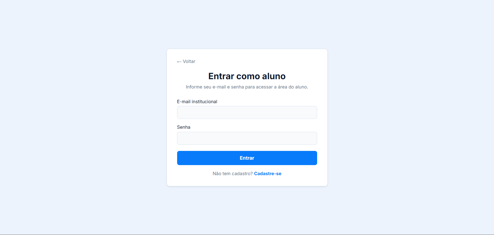

\- Cadastro

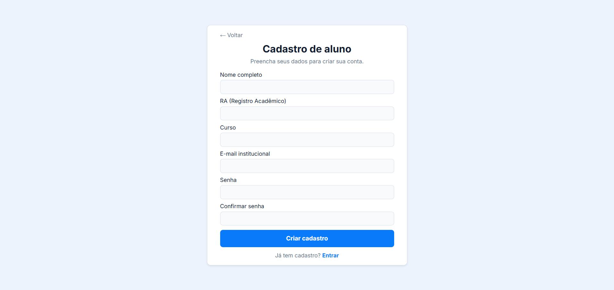

\- Dashboard

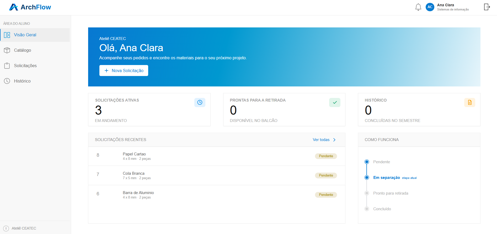

\- Catálogo de materiais

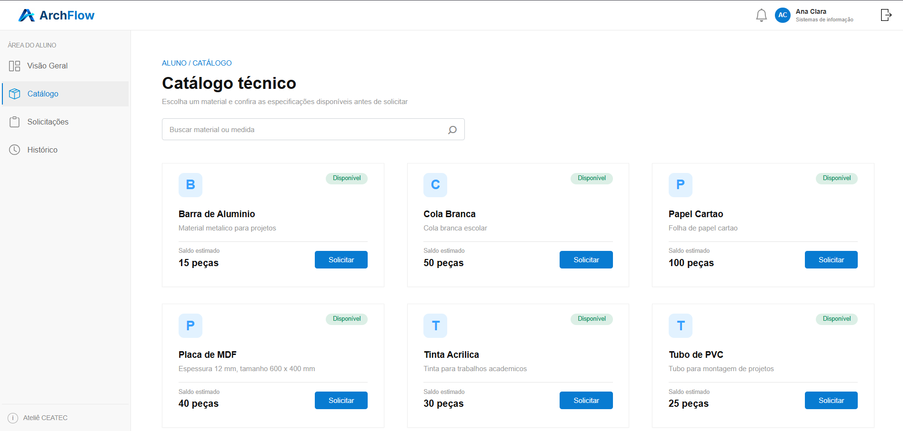

\- Solicitações

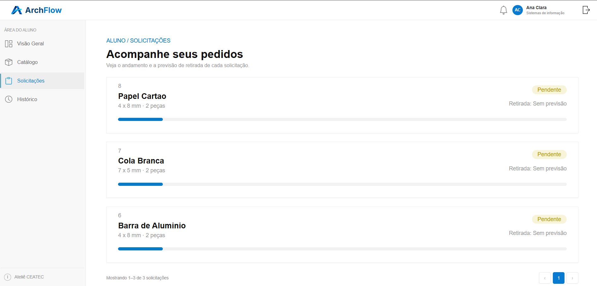

\- Histórico

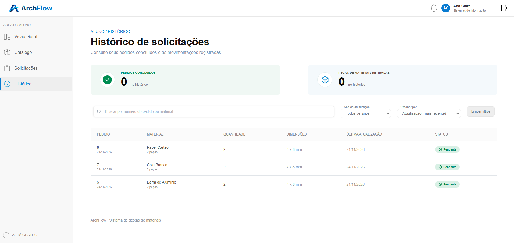

### **8.2 Telas do Responsável**
\- Login\
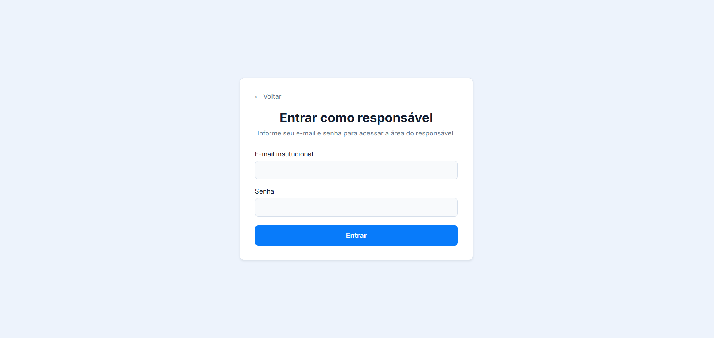

\- Dashboard administrativo.\
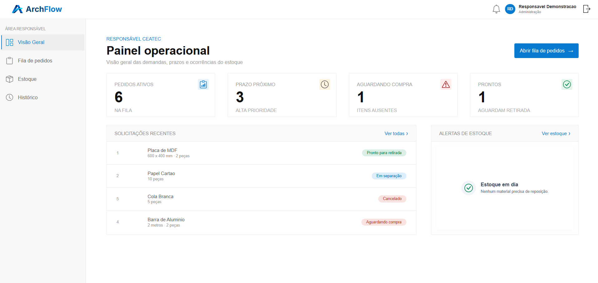

\- Fila de solicitações.

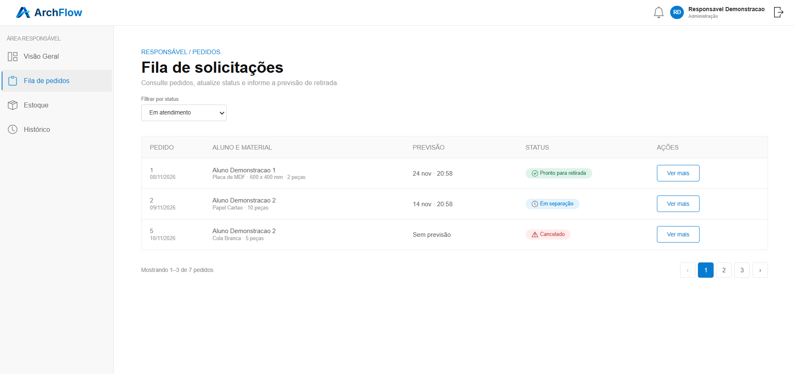

\- Gerenciamento de pedidos e estoque.

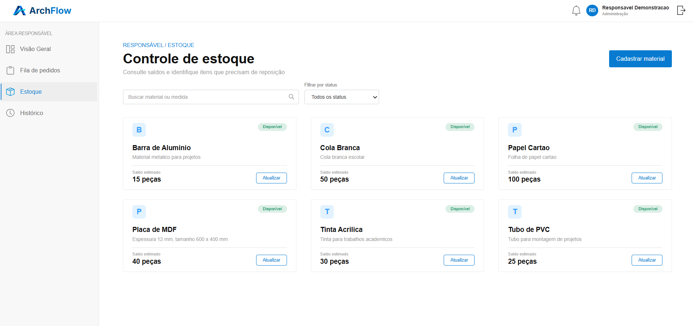

\- Histórico

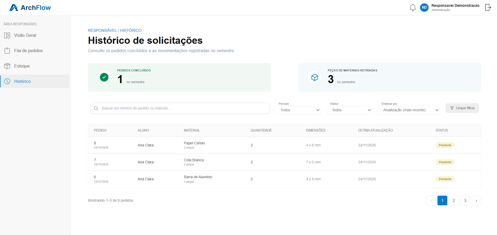

## 9. Como rodar

O capítulo 9 corresponde ao [README do repositório principal](../README.md#instalação-em-máquina-limpa), com instruções para clonar os dois repositórios, configurar o ambiente e iniciar o ArchFlow.

## 10. Conclusão

O desenvolvimento do ArchFlow permitiu criar uma solução para facilitar o gerenciamento de materiais e solicitações do Ateliê CEATEC, buscando tornar os processos mais organizados, acessíveis e eficientes. A proposta surgiu da necessidade de melhorar o acompanhamento dos materiais disponíveis, o registro das solicitações e a comunicação entre alunos e responsáveis pelo atendimento.

Ao longo do projeto, foram desenvolvidas funcionalidades voltadas à autenticação de usuários, consulta ao catálogo de materiais, registro e acompanhamento de solicitações, controle de estoque, histórico, prazos e notificações. A integração entre frontend, backend e banco de dados possibilitou a construção de uma aplicação que reúne essas funcionalidades em um único sistema.

Além dos resultados técnicos, o projeto proporcionou à equipe a oportunidade de aplicar, na prática, os conhecimentos adquiridos durante o curso, envolvendo desenvolvimento web, banco de dados, integração entre tecnologias, versionamento de código, documentação e trabalho em equipe. Também contribuiu para o desenvolvimento da capacidade de lidar com desafios e tomar decisões ao longo do processo de desenvolvimento.

Dessa forma, o ArchFlow representa a aplicação dos conhecimentos acadêmicos na construção de uma solução voltada a uma necessidade real, contribuindo para a organização dos processos do Ateliê CEATEC e servindo como experiência para o desenvolvimento de projetos futuros

## 11. Anexos

* [Repositório principal do ArchFlow](https://github.com/MatheusMansano06/pi4-0102-g7-backend-1) — API Java, Docker Compose, scripts SQL, contratos, ADRs e README.
* [Repositório da interface web](https://github.com/anadiasxavier/pi4-0102-g7-frontend) — aplicação React, fluxos, fichas de tela, testes e configuração do nginx.
* [Quadro do grupo 7 no OpenProject](https://srv1889234.hstgr.cloud/projects/pi-iv-0102-g7/work_packages) — histórias, tarefas, responsáveis e registros de conclusão.
* [Release v1.0 do repositório principal](https://github.com/MatheusMansano06/pi4-0102-g7-backend-1/releases/tag/v1.0) — versão entregue da API e da configuração de execução.
* [Release v1.0 da interface web](https://github.com/anadiasxavier/pi4-0102-g7-frontend/releases/tag/v1.0) — versão correspondente do frontend.
* [GitHub Actions · CI \#154 do backend](https://github.com/MatheusMansano06/pi4-0102-g7-backend-1/actions/runs/43786867187) — última execução verificada, aprovada na main em 15/11/2026 para o commit 6eb0df1 da v1.0.
* SonarQube do backend — ferramenta não integrada à entrega v1.0. A situação da análise de qualidade está descrita no item 7.2.
* [Evidências de integração do backend](https://github.com/MatheusMansano06/pi4-0102-g7-backend-1/blob/v1.0/docs/integracao/H11-fechamento.md) e [roteiro e capturas do frontend](https://github.com/anadiasxavier/pi4-0102-g7-frontend/blob/v1.0/docs/integracao/H11-fechamento.md) — ensaio do Compose, testes com PostgreSQL e fluxo da solicitação até a conclusão.
